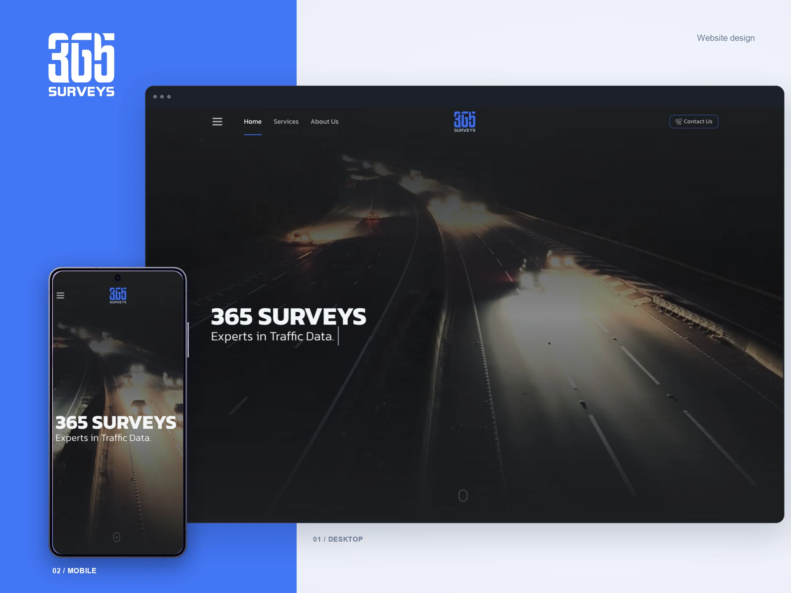

# 365 Surveys



This website was built for **Fewzed Ltd** to present 365 Surveys, its transportation data services, and its case studies.

The site includes pages for services, traffic counts, case studies, company information, and contacting the team, with animated interactions and responsive layouts.

**Website:** [365surveys.vercel.app](https://365surveys.vercel.app/)

## Technology and packages

The project uses Nuxt 4 and Vue 3 with server-side rendering. Dependencies are listed in `package.json` and pinned in `package-lock.json`.

| Package | Purpose |
| --- | --- |
| `nuxt` and `vue` | Application framework, pages, routing, server-side rendering, and UI. |
| `@nuxtjs/tailwindcss` | Tailwind CSS integration for responsive styling. |
| `@nuxt/icon` | Icon components used throughout the site. |
| `@nuxt/image` and `ipx` | Responsive image sizes and WebP image delivery. |
| `@nuxtjs/sitemap` | Sitemap generation for the public pages. |
| `@vueuse/core` and `@vueuse/nuxt` | Vue composables and Nuxt integration. |
| `gsap` | Page and component animations, including ScrollTrigger. |
| `axios` | Requests from the contact form. |

## Local development

Use a Node.js version supported by `package.json`: `^22.22.3 || ^24.15.0 || >=26.0.0`.

Install the locked dependencies:

```bash
npm ci
```

Start the development server on port 3001:

```bash
npm run dev -- --port 3001
```

## Build and preview

Build the application for production:

```bash
npm run build
```

Preview the production build locally:

```bash
npm run preview
```

Static generation is also available with `npm run generate`.

## Deployment

The production server runs the Nuxt Node.js build with PM2. Build the app, then start it on port 3001:

```bash
npm run build
PORT=3001 pm2 start .output/server/index.mjs --name "365surveys"
```

To restart the existing process after deploying an update:

```bash
pm2 restart 365surveys
```

## Project structure

- `pages/` — Site pages and routes.
- `components/` — Shared navigation, service and case-study cards, form, and UI components.
- `layouts/` — Shared page layout.
- `plugins/` — GSAP integration.
- `assets/css/` — Global styles and Tailwind CSS.
- `assets/images/` — Site illustrations, logos, and README cover image.
- `assets/videos/` — Site video assets.
- `public/images/` — Optimized WebP images served by Nuxt Image.
- `nuxt.config.ts` — Nuxt modules, site metadata, and sitemap configuration.
